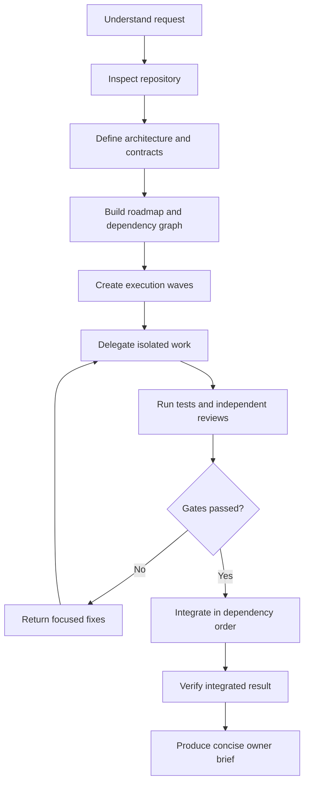

# Agentic Integrator

A Claude Code skill for planning, delegating, reviewing, and integrating multi-agent software development with dependency-aware roadmaps, isolated worktrees, independent reviewers, and concise owner briefs.

> [!NOTE]
> This is an early release. Use repository-specific tests and engineering judgment as the final authority.

## Why

Running several coding agents is easy. Coordinating them safely is not. Without an explicit workflow, agents can edit overlapping files, implement incompatible assumptions, review their own work, merge tasks out of dependency order, and overwhelm the project owner with raw reports.

Agentic Integrator gives the lead Claude Code session a repeatable process for coordinating that work while keeping important decisions under human control.

## Workflow



## What it does

- Inspects the repository and existing instructions before planning.
- Defines or updates architecture, contracts, acceptance criteria, and non-goals.
- Converts work into a dependency graph and safe execution waves.
- Assigns narrow scopes and explicit file ownership to workers.
- Prefers isolated Git branches or worktrees for parallel changes.
- Uses independent specification, code-quality, security, and migration reviewers as risk requires.
- Verifies worker claims directly before integration.
- Integrates approved changes in dependency order and re-runs checks afterward.
- Converts detailed agent reports into short owner decisions.

## Owner brief

The project owner should not need to read every worker transcript. A normal decision brief looks like this:

```text
Outcome: Wave 1 schema and contract tests completed.
Evidence: two scoped commits; schema build passed.
Risk: security review found a refresh-token race condition.
Recommendation: amend the contract before implementation.
Decision needed: approve the atomic-update approach.
```

Raw evidence remains available when deeper inspection is useful.

## Installation

### Requirements

- Node.js with `npx`
- Claude Code
- Git when branches or worktrees are used

### Global installation

Replace `<github-user>` with the repository owner's GitHub username:

```bash
npx skills add <github-user>/agentic-integrator \
  --skill agentic-integrator \
  --agent claude-code \
  --global
```

For a non-interactive installation, add `--yes`.

### Project-only installation

Run from the target repository and omit `--global`:

```bash
npx skills add <github-user>/agentic-integrator \
  --skill agentic-integrator \
  --agent claude-code
```

### Interactive installation

```bash
npx skills add <github-user>/agentic-integrator
```

Select `agentic-integrator`, Claude Code, and the desired scope when prompted.

### Verify

```bash
npx skills list --global --agent claude-code
test -f ~/.claude/skills/agentic-integrator/SKILL.md && echo "Installed"
```

### Manual fallback

If the installer reports success but Claude Code cannot see the skill:

```bash
git clone https://github.com/<github-user>/agentic-integrator.git \
  ~/.claude/skills/agentic-integrator
```

Update a manual installation with:

```bash
git -C ~/.claude/skills/agentic-integrator pull --ff-only
```

## Usage

Start explicitly:

```text
Use the agentic-integrator skill to plan and deliver this feature.
Inspect the repository first, build a dependency-aware roadmap, delegate isolated tasks,
use independent reviewers, integrate only verified work, and give me concise owner briefs.
```

Resume existing work:

```text
Use the agentic-integrator skill to continue the current roadmap.
Reconstruct the current state from repository artifacts and Git before delegating new work.
```

Review without modifying anything:

```text
Use the agentic-integrator skill to review the current integration branch.
Do not change or merge anything. Return blockers, important risks, and recommended actions.
```

## Human approval boundaries

The integrator pauses before:

- changing a frozen contract or architecture;
- accepting a meaningful security, privacy, cost, or data-integrity trade-off;
- expanding scope materially;
- performing destructive or difficult-to-reverse actions;
- merging despite a blocking review finding;
- using credentials, production access, or external authority not already granted.

It should recommend one option and explain consequences instead of forwarding a long transcript.

## Repository structure

```text
agentic-integrator/
├── README.md
├── SKILL.md
├── agents/
│   └── openai.yaml
├── references/
│   ├── agent-roles.md
│   ├── dependency-graph.md
│   ├── integration-gates.md
│   ├── owner-brief.md
│   └── planning-workflow.md
└── scripts/
    └── verify-worktrees.sh
```

`SKILL.md` contains the operating procedure. Detailed material is loaded from `references/` only when relevant. The bundled script performs read-only Git worktree inventory checks.

## Design principles

- Contracts before parallel implementation.
- Dependency order before scheduling.
- One clear owner per file or module.
- Independent review before integration.
- Evidence before status claims.
- Human approval for consequential decisions.
- Concise summaries by default; raw details on demand.
- Repository-specific instructions override generic conventions.
# agentic-integrator
