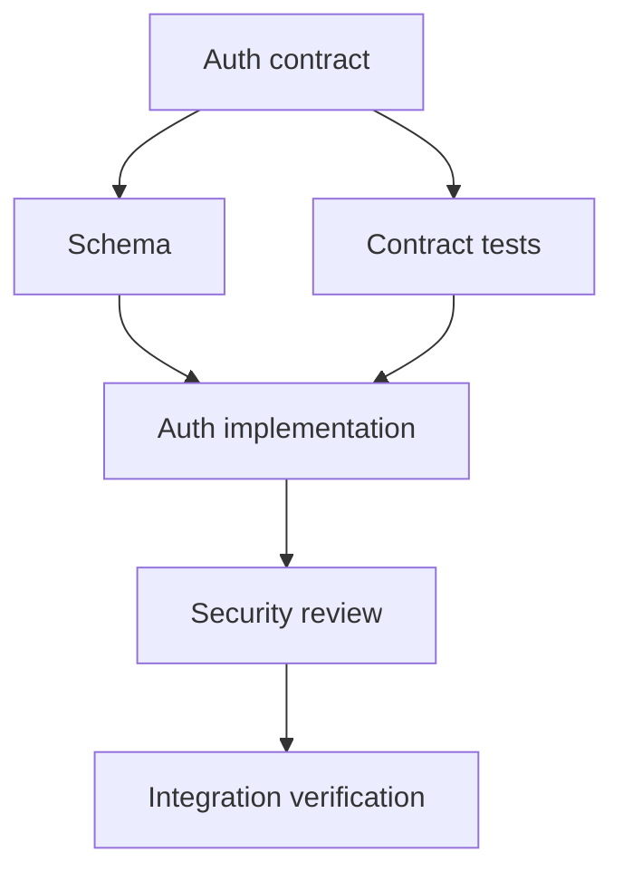

# Dependency Graph and Execution Waves

## Contents

1. Task record
2. Edge types
3. Building the graph
4. Forming waves
5. Conflict rules
6. Example

## 1. Task record

Use this compact schema:

```yaml
id: S1-T2
outcome: Implement refresh-token rotation
depends_on: [S1-T1]
owns:
  - src/auth/refresh.service.ts
  - src/auth/refresh.service.spec.ts
reads:
  - docs/contracts/auth.md
acceptance:
  - Concurrent use of one refresh token permits one success
  - Reuse revokes the affected session
verify:
  - npm run test -- refresh.service.spec.ts
reviewers: [specification, security]
risk: high
```

An outcome describes observable completion. Avoid task names such as “work on auth.”

## 2. Edge types

- **Contract:** a task consumes an API, schema, event, or invariant defined by another task.
- **Code:** a task imports or extends code produced by another task.
- **Data:** a task needs a migration or persisted state produced earlier.
- **Verification:** an end-to-end test needs multiple implementations first.
- **Release:** rollout or deployment requires preceding operational work.

Record the reason for surprising edges. Do not add dependencies merely because tasks belong to the same feature.

## 3. Building the graph

1. Start from the end-to-end acceptance path.
2. Identify contracts and irreversible decisions.
3. Split implementation by cohesive ownership boundaries.
4. Add review and integration tasks explicitly.
5. Detect cycles. A cycle usually means the boundary or contract is underspecified.
6. Identify the critical path and owner decisions on it.

## 4. Forming waves

Wave 0 normally contains discovery, contract work, and shared foundations.

Wave N may contain every ready task whose dependencies are complete and whose write scopes do not overlap. Review may run in parallel with unrelated implementation but must finish before the reviewed task is integrated.

Use sequential work when:

- tasks share files;
- one task is likely to change the other's contract;
- migrations must be applied in a strict order;
- the cost of reconciling divergent assumptions exceeds the parallelism benefit.

## 5. Conflict rules

Treat these as conflicts even if filenames differ:

- two tasks change the same public interface;
- two migrations depend on ordering of the same tables;
- generated files depend on separately edited sources;
- package or lockfile changes come from multiple branches;
- tests and implementation assume different module names;
- multiple tasks edit central configuration or dependency wiring.

Give shared files to the integrator, create one foundation task, or sequence the work.

## 6. Example



Schema and contract tests can run in parallel after the contract is frozen. Implementation waits for both. Security review waits for implementation. Integration verification waits for all blockers to be resolved.
